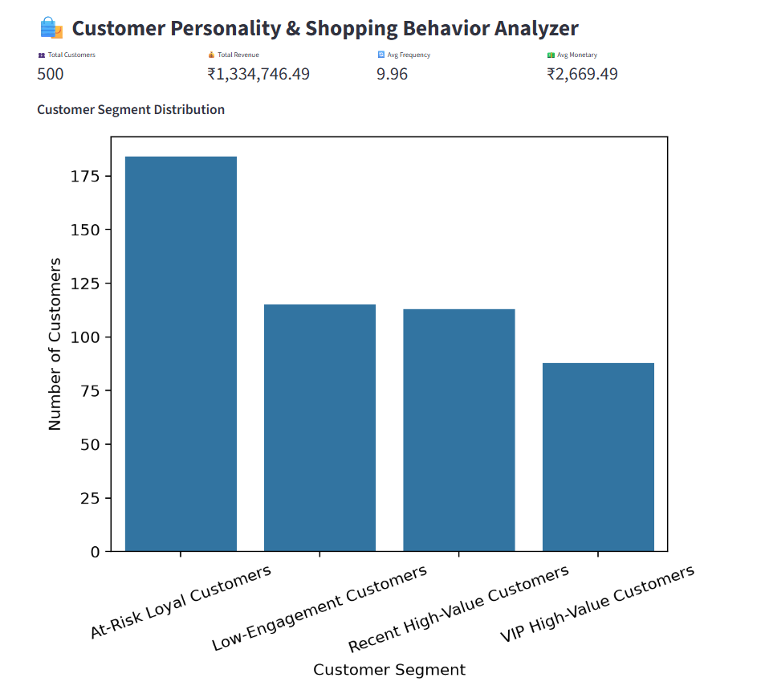
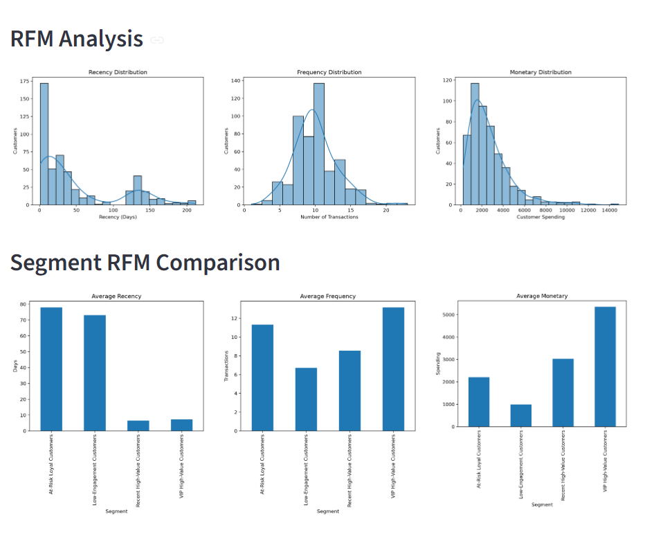
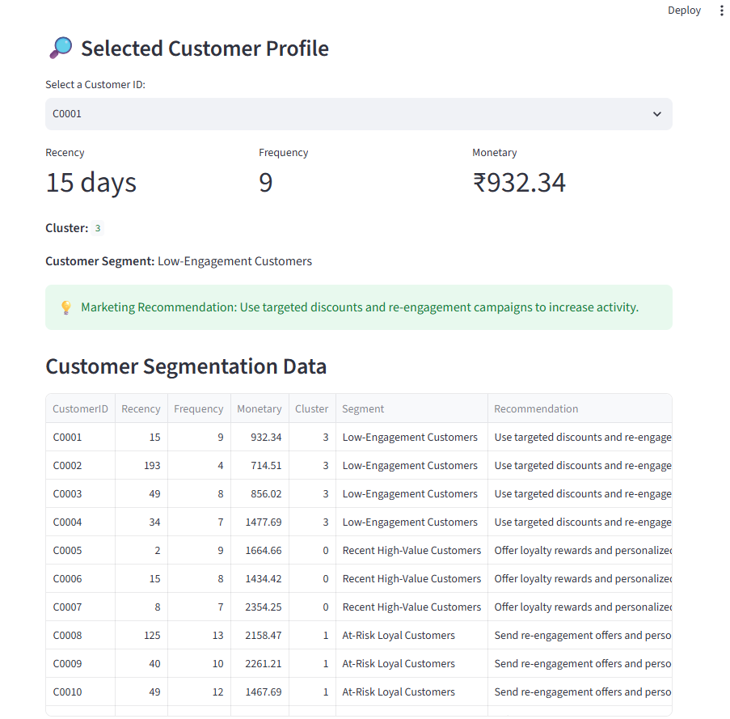

# 🛍️ Customer Personality & Shopping Behavior Analyzer

An end-to-end Data Science project that analyzes customer purchasing behavior, segments customers using **RFM Analysis and K-Means Clustering**, and generates targeted marketing recommendations through an interactive **Streamlit dashboard**.

## 📌 Project Overview

Businesses need to understand not only how much customers spend, but also how recently and frequently they purchase.

This project demonstrates how transaction data can be transformed into actionable customer insights through data cleaning, exploratory analysis, machine learning, customer segmentation, and marketing recommendations.

> **Dataset Note:** This project uses synthetic transaction data. It does not contain Trillium Mall / VR Ambarsar's actual customer transactions or establish the causes of its vacancy.

## 🎯 Project Objectives

- 🧹 Clean and preprocess transaction data.
- 📊 Perform Exploratory Data Analysis (EDA).
- 👥 Calculate customer-level Recency, Frequency, and Monetary (RFM) metrics.
- 🔄 Apply log transformation and feature scaling.
- 📉 Evaluate clusters using the Elbow Method and Silhouette Score.
- 🤖 Apply K-Means clustering to segment customers.
- 🔍 Interpret customer behavior and assign meaningful segment names.
- 💡 Generate targeted marketing recommendations.
- 🌐 Build an interactive Streamlit dashboard.

## 🛠️ Technologies Used

- 🐍 Python
- 🐼 Pandas and NumPy
- 📊 Matplotlib and Seaborn
- 🤖 Scikit-learn
- 🌐 Streamlit
- 📓 Jupyter Notebook

## 📁 Dataset Description

The synthetic transaction dataset contains the following fields:

| Column | Description |
|---|---|
| `CustomerID` | Unique customer identifier |
| `InvoiceDate` | Transaction date |
| `Product` | Product purchased |
| `Category` | Product category |
| `Quantity` | Quantity purchased |
| `UnitPrice` | Price per unit |
| `TotalAmount` | Quantity multiplied by unit price |

The dataset includes data-quality issues for cleaning practice, such as duplicate records, missing values, and invalid negative values.

## 🔄 Project Workflow

### 1. 📥 Data Loading and Inspection
- Inspected dataset shape, columns, data types, missing values, duplicates, and summary statistics.

### 2. 🧹 Data Cleaning
- Removed duplicate records.
- Handled missing customer IDs and unit prices.
- Converted transaction dates into datetime format.
- Removed invalid non-positive quantities and prices.
- Created the `TotalAmount` column.

### 3. 📊 Exploratory Data Analysis (EDA)
- Analyzed customer and transaction counts.
- Calculated total revenue and average transaction value.
- Explored product and category distributions.

### 4. 👥 RFM Analysis

Three customer-level metrics were calculated:

- **Recency:** Number of days since the customer's most recent purchase. Lower values indicate more recent purchases.
- **Frequency:** Number of transactions made by the customer.
- **Monetary:** Total spending by the customer.

### 5. 🔧 Feature Transformation and Scaling
- Applied `log1p` transformation to reduce skewness.
- Used `StandardScaler` to standardize RFM features before clustering.

### 6. 📉 Cluster Evaluation
- Used the Elbow Method to examine changes in inertia.
- Used Silhouette Score to evaluate cluster separation.
- Compared cluster sizes and RFM profiles.

### 7. 🤖 K-Means Clustering
- Applied K-Means to group customers based on RFM behavior.
- Selected **K = 4** as a working choice to explore four interpretable business segments.

### 8. 🧠 Customer Segmentation
Four customer segments were identified:

- 🟢 **Recent High-Value Customers**
- 🔵 **At-Risk Loyal Customers**
- 🟣 **VIP High-Value Customers**
- 🟠 **Low-Engagement Customers**

### 9. 💡 Marketing Recommendations
Each customer segment was mapped to a suggested marketing strategy based on its RFM profile.

## 📉 Clustering Decision

The highest Silhouette Score occurred at **K = 2**. However, this demonstration uses **K = 4** as a working business-interpretability choice to explore more detailed customer groups.

Therefore, K = 4 is **not claimed to be the mathematically optimal solution**. In a real deployment, the number of clusters should be validated using actual customer data, business objectives, and campaign outcomes.

## 💡 Customer Segments and Marketing Strategies

| Customer Segment | Suggested Strategy |
|---|---|
| Recent High-Value Customers | Loyalty rewards and personalized product recommendations |
| At-Risk Loyal Customers | Re-engagement offers and personalized discounts |
| VIP High-Value Customers | Exclusive offers, premium rewards, and early access |
| Low-Engagement Customers | Targeted discounts and re-engagement campaigns |

These recommendations are illustrative and should be tested before real-world implementation.

## 📸 Dashboard Screenshots

### 1. 📊 Dashboard Overview

Displays key performance indicators and customer segment distribution.



### 2. 📈 RFM Analysis and Segment Comparison

Visualizes Recency, Frequency, and Monetary distributions, along with average RFM comparisons across customer segments.



### 3. 🔎 Customer Profile and Marketing Recommendation

Displays a selected customer's RFM metrics, cluster, segment, personalized marketing recommendation, and the customer segmentation table.



## 📂 Project Structure

```text
customer-personality-shopping-behavior-analyzer/
├── transactions.csv
├── cleaned_transactions.csv
├── rfm_customer_segments.csv
├── customer_behavior_analysis.ipynb
├── app.py
├── requirements.txt
├── README.md
└── screenshots/
    ├── dashboard-overview.png
    ├── rfm-analysis.png
    └── customer-profile.png
```

## 🚀 How to Run the Project

### Step 1: Clone the repository

```bash
git clone https://github.com/LakshpreetKaur02/customer-personality-shopping-behavior-analyzer.git
cd customer-personality-shopping-behavior-analyzer
```

### Step 2: Create a virtual environment (recommended)

**Windows:**

```bash
python -m venv .venv
.venv\Scripts\activate
```

**macOS/Linux:**

```bash
python -m venv .venv
source .venv/bin/activate
```

### Step 3: Install dependencies

```bash
pip install -r requirements.txt
```

### Step 4: Launch the dashboard

```bash
python -m streamlit run app.py
```

The dashboard reads `rfm_customer_segments.csv`. Keep this file in the same project directory as `app.py`.

## 📌 Evaluation and Limitations

- Cluster evaluation considered inertia, the Elbow Method, Silhouette Score, cluster sizes, and RFM profile interpretability.
- Silhouette Score favored K = 2, while K = 4 was retained as a working choice for more detailed business segmentation.
- The dataset is synthetic and does not represent the actual customers of any specific retailer.
- Marketing recommendations are hypotheses, not proven campaign outcomes.
- Real-world use would require suitable transaction data and validation against business results.

## 🔮 Future Improvements

- Validate the approach using real, permissioned retail transaction data.
- Experiment with additional clustering methods and features.
- Track campaign response, customer retention, and revenue outcomes.
- Add interactive filters and downloadable reports.
- Deploy the dashboard online.

## 👩‍💻 Author

**Lakshpreet Kaur**

This project demonstrates an end-to-end workflow from transaction data to customer insights, machine learning-based segmentation, marketing recommendations, and an interactive dashboard.

---

⭐ If you find this project useful, feel free to explore the code and share your feedback!
